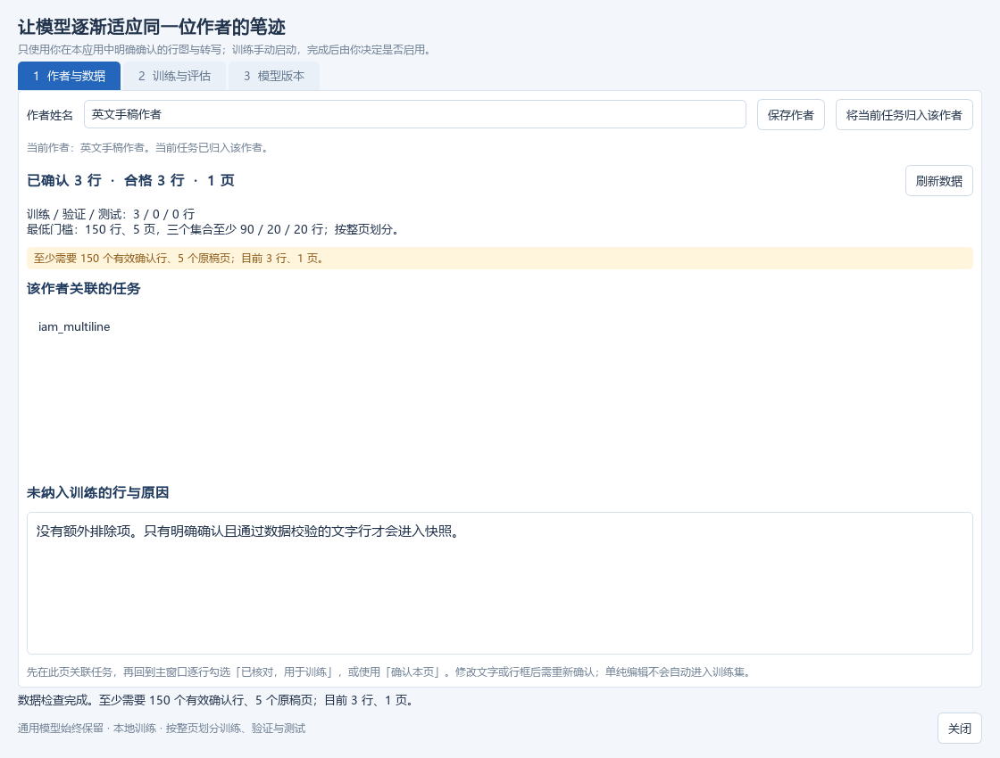
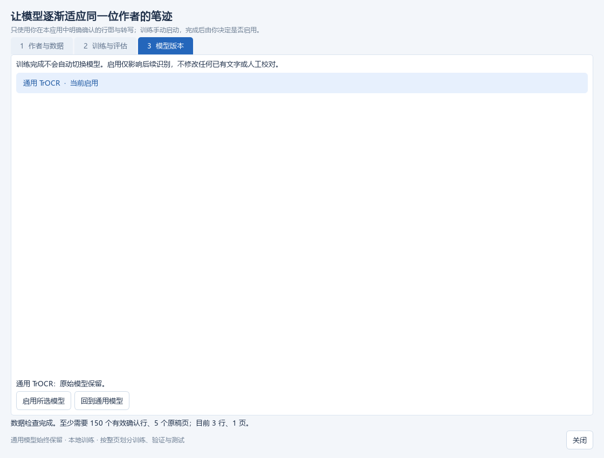
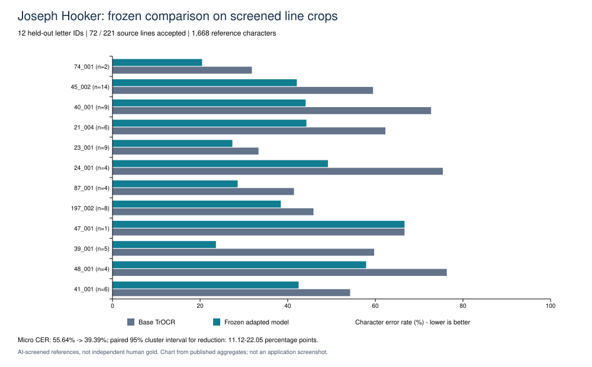

# 测试证据：界面截图、执行记录与历史验证

这里集中保存可公开核对的本地测试证据。截图用于说明界面状态；自动测试日志用于查看逐项执行结果；识别效果见另行固定模型与材料的 [Hooker 对照实验](../experiments/joseph-hooker-2026-10/README.md)。这些材料由 AI 辅助整理，均不是独立人工验收或 GitHub Actions 签名证明。

## 当前源码的自动测试执行记录

针对应用源码提交 [`8cd0f3e`](https://github.com/shijunming09-png/handwriter_is_awesome/commit/8cd0f3ec140bdee35c802598d0feff03e0f4730f)，于 2026-10-27 重新执行完整测试集并保留结果：**79 passed，failures / errors / skipped 均为 0**。

- [pytest 标准输出](records/pytest-stdout.txt)：实际进程输出；其中本机工作区路径被替换为 `<LOCAL_WORKSPACE>`。
- [JUnit XML](records/pytest-junit.xml)：79 项测试名称、逐项耗时、计数与本机执行时间；移除了主机名和本地工作区路径。
- [执行摘要及源码 SHA-256](records/pytest-summary.json)：命令、Python 版本、退出码、环境参数、源码和测试文件的摘要。

源码 SHA-256 对应本机工作副本的原始字节，Git 检出时的换行转换可能改变摘要。发布前已检查 30 份源码和测试文件，其原始字节或 LF 规范化内容与上述提交一致。

执行命令与环境：

```powershell
$env:QT_QPA_PLATFORM = 'offscreen'
$env:HF_HUB_OFFLINE = '1'
$env:TRANSFORMERS_OFFLINE = '1'
python -m pytest tests -q --junitxml ./build/pytest-junit.xml --basetemp ./build/test-temp
```

运行前需安装仓库依赖。测试使用临时目录和合成素材，不会微调实际模型。`offscreen` GUI 测试不等于人工操作完整桌面的验收；通过自动测试也不能推导识别准确率或新硬件环境的兼容性。

## 历史界面截图

以下为已保存的 Handwriter 2.0 界面截图，早于标签编码修复；此次按原 PNG 字节复制，未裁剪、覆盖文字或重新生成。截图本身及本机文件时间不能独立证明拍摄日期，SHA-256 记录在 [证据清单](evidence-manifest.json)。

### 数据门槛提示

实际显示 **3 条合格行 / 1 页**，低于 **150 行 / 5 页** 的门槛，并列出训练 / 验证 / 测试最低数量。它展示数据检查和不足提示，不能证明已经完成训练。



### 训练与评估的等待状态

实际显示“阶段：等待”，未建立数据快照，历史记录及逐行对照为空。它展示训练界面及控件状态，不能作为训练完成、取消恢复成功或 CER 改善的证据。


### 模型版本界面

实际显示“通用 TrOCR · 当前启用”及启用 / 回退入口，没有显示已完成的个人模型。它展示版本管理入口和当前通用模型状态；实际切换流程的历史功能记录见下一节。



## 历史本地功能验证摘录

[脱敏历史记录](records/historical-functional.json) 从既有 JSON 报告逐字段摘录状态、数量和完整性结果，去掉本地路径、作者/任务标识及手稿原文和预测。原记录对应 **旧标签编码的 Handwriter 2.0**，不能视为修正版重新进行过 GPU 训练或打包 EXE 验收。

| 历史项目 | 记录支持的范围 |
| --- | --- |
| 合成数据流程 | 5 页 / 150 行，300 DPI，90 / 30 / 30 划分，生产数据门槛通过，无准确率结论。 |
| 打包 EXE 微型训练 | 1 次 LoRA 更新，参数发生变化，检查点和发布模型完整性通过；内部小样本绕过正常数据门槛。小样本模型对照未改善。 |
| 取消与恢复 | 取消 / 取消 / 完成；另外连续与恢复各训练 2 步，96 个适配器张量最大差为 0。 |
| 打包 EXE 识别与导出 | 通用 / 个人模型分别完成 1 页、3 行识别，Word / TXT 导出内容和行序一致。 |
| 本地离线加载 | 对应历史进程的 socket 连接尝试为 0；这不是物理断网或完整网络隔离证明。 |
| CPU 重载 | 源码引擎强制 CPU 后载入包训练模型并完成识别；不是打包 EXE 的 CPU 实测。 |

旧版原始手稿截图和转写未在此重新分发。历史记录涉及的 IAM 来源及使用说明见 [素材来源说明](../../tests/fixtures/SOURCES.md)。

## 模型效果的可视化

以下是从已公开逐页汇总生成的图，**不是软件截图，也不是新增实验**。每页 `n` 为纳入行数；每页的参考字符数不同，总 CER 按字符数加权，不是 12 个页级百分比的简单平均。



该实验纳入 221 条源行中的 72 条，参考文字尚未独立人工复核。完整方法、统计限制及复算脚本见 [实验报告](../experiments/joseph-hooker-2026-10/README.md)。

## 可核验范围

读者可以检查 PNG 字节摘要、JUnit 中的测试列表和计数，并复算公开的统计汇总。日志、截图和本地时间仍由本项目提供，不构成第三方签名或独立验收。未公开原始记录的摘要，只能由持有那些原文件的人核对；不能仅凭摘要验证手稿标签或模型预测。
